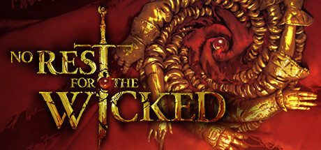

**No Rest for the Wicked by Moon Studios (Early Access 2024) is a hand-painted isometric action RPG with soulslike combat weight.**

---

## 📖 About

No Rest for the Wicked by Moon Studios (Early Access 2024) is a hand-painted isometric action RPG with soulslike combat weight. Set on the cursed island of Sacra, you battle through beautifully rendered environments with methodical combat that punishes button mashing.

## ⚠️ Problems Without Trainer

| Problem | Status |
|---------|--------|
| Stamina exhaustion leaves no defensive options against fast multi-hit bosses | ✅ Solved |
| Gear repair costs consume gold reserves faster than dungeon income provides | ✅ Solved |
| Attribute point investment locks character builds after early-game mistakes | ✅ Solved |
| Enemy damage scales past survivability without perfect dodge timing mastery | ✅ Solved |
| Crafting material drops require farming specific enemy variants repeatedly | ✅ Solved |

## ✅ Solution

The **No Rest for the Wicked Trainer** solves all these issues, giving you complete control so you can focus on enjoying the game.

## 🎯 Features

- Unlimited Resources / Currency
- God Mode / Invincibility
- Instant Skill & Ability Cooldown
- One-Hit Kill
- Freeze Timers
- Unlock All Items & Achievements
- Custom Speed Multiplier
- Infinite Stamina / Energy

## 🚀 Quick Start

1. **Disable Windows Defender** temporarily (trainer may trigger false positive)
2. Get the trainer from the button above
3. Launch No Rest for the Wicked
4. Run the trainer as Administrator
5. Use the hotkeys to activate cheats in-game

## 💎 Free vs Pro

| Feature | Free | Pro |
|---------|------|-----|
| God Mode | ✅ | ✅ |
| Unlimited Resources | ✅ | ✅ |
| Advanced Cheats | ❌ | ✅ |
| Auto-Updates | ❌ | ✅ |
| Priority Support | ❌ | ✅ |

## 💻 Requirements

- Windows 10 / 11 (64-bit)
- No Rest for the Wicked (any version)
- .NET Framework 4.8+
- DirectX 11+

## 🍎 macOS

## ⚖️ Legal

Educational and single-player use only.

---

